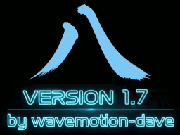
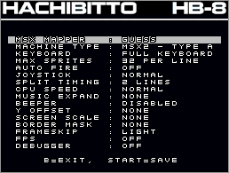
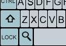
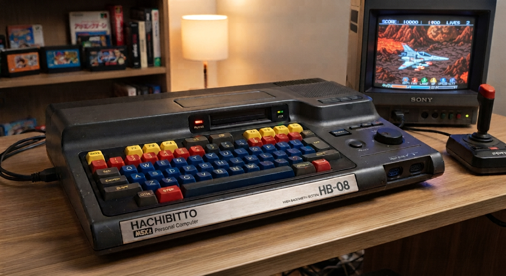
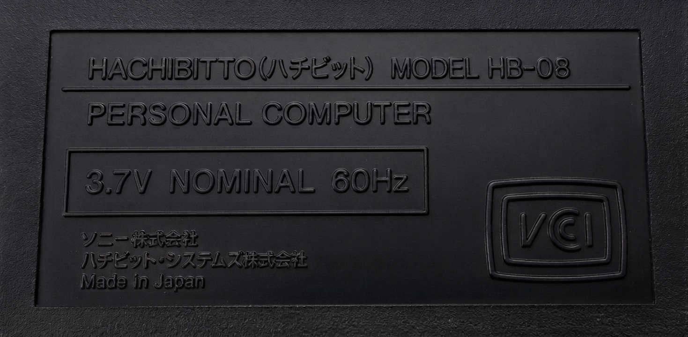
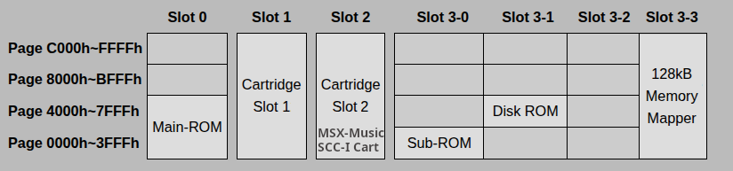
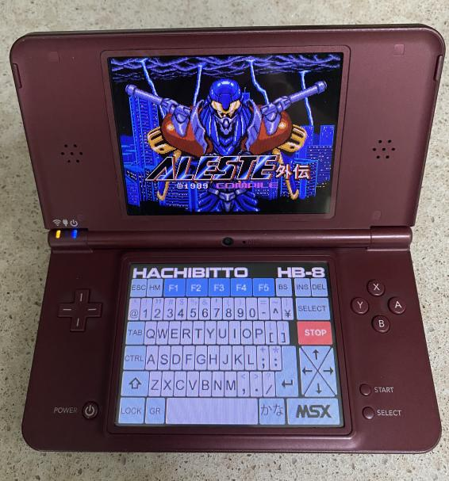

# Hachibitto - MSX2 Emulator

Welcome to Hachibitto (pronounced Ha-Chi-Bee-Toe). A Fantasy MSX/MSX2 Console for your DS/DSi/XL/LL handheld.

# Donations Welcome (but never required!)

These hobby emulators have been a labor of love. An embarassing amount of development time has gone into it as I've strived to provide an enjoyable retro experience on the DS handheld. It's free to use and always will be, however if you feel inclined to buy me a virtual coffee for the effort, that would be beyond amazing!

Features :
-----------------------
* Rock-solid 60Hz sync to the DSi/XL/LL for a tear-free experience (DS-Lite/Phat supported with light frameskip).
* Loads .ROM cartridge files up to 1MB (DS-Lite/Phat) or 4MB (DSi). 
* Two cart slots supported (if a 2nd cart is utilized, it cuts the max .ROM filesizes above in half).
* Loads .DSK disk files that are single side (360K) or double sided (720K) with in-game disk swap.
* Emulated machine is 256K of User RAM and 128K of VRAM.
* MEGARAM SCC option available to boost system memory to 512K (DS-Lite) or 1024K (DSi) with SCC support.
* Fully configurable keys for the 12 NDS keys to any combination of joystick/keyboard.
* Save and Restore states so you can pick up where you left off on a per-game basis.
* Standard PSG, 2x PSG, SCC, SCC+ and FM-PAC (MSX-MUSIC + SRAM) available.
* SRAM carts backed to SD card automatically.
* Slide-n-Glide style Joystick configuration to make climbing ladders in games like Chuckie-Egg more forgiving (try it - you'll like it!).
* Overscan support for the few games that extend past the 212 scanline "limit". See options.
* Arkanoid paddle controllers supported (only 2 games known to make use of it - hold B button to speed up paddle movement).
* High Score saving for 10 scores with initials, date/time.
* Favorites list so you can mark games as 'like' or 'love' - a yellow or red heart icon will mark your favorite games.
* Solid Z80 core that passes the ZEXDOC test suite (covering everything except undocumented flags which are partially supported for the few games that need them).
* Game artwork (box cover, etc) is supported - use PNG files of 256 pixels wide by up to 512 pixels tall and place in /roms/art or /roms/msx/art (or same directory as game).
* Minimal design aesthetic - pick game, play game. Runs unpatched from your SD card via TWL++ or similar.

Copyright :
-----------------------
Hachibitto is Copyright (c) 2026 Dave Bernazzani (wavemotion-dave)

As long as there is no commercial use (i.e. no profit is made),
copying and distribution of this emulator, it's source code
and associated readme files, with or without modification, 
are permitted in any medium without royalty provided this 
copyright notice is used and wavemotion-dave (Hachibitto),
and Marat Fayzullin (fMSX core) are thanked profusely.

The sound driver (ay38910 and scc) are libraries from FluBBa (Fredrik Ahlström) 
and those copyrights remain his.

lzav compression (for save states) is Copyright (c) 2023-2025 Aleksey 
Vaneev and used by permission of the generous MIT license.

The MSX/MSX2 logos are used without permission but with the maximum
of respect and love.

The Hachibitto emulator is offered as-is, without any warranty.

Special Thanks :
-----------------------
Thanks to Flubba for the AY38910 and SCC sound cores. You can seek out his latest and greatest at https://github.com/FluBBaOfWard

Also thanks to Marat Fayzullin, as the author of fMSX - which is where the CZ80 CPU core and initial VDP9938 handling came from.

The ROM Database is courtesy of https://romdb.vampier.net/

And the most special of thanks to Nishi.

Options :
-----------------------

* MSX Mapper - Generally leave as 'GUESS' as it will search the internal database (10,000 games) and if not found will attempt to determine the mapper from the ROM size/contents. 
* Machine Type - Usually leave this as the normal MSX2 machine type. Switch to MSX1 Legacy if you want to force the MSX1 VDP handling for a few games that don't play well with MSX2.
* Keyboard Type - Usually full keyboard layout but you can select the simplified Alpha keyboard which helps when playing text-heavy games that need a lot of key input.
* Max Sprites - Normally real hardware can only render 4/8 sprites per line (MSX1 legacy vs MSX2) but the emulation allows all 32 to be displayed without flicker.
* Auto Fire - can be set for Button 1 and/or Button 2.
* Joystick - Generally leave at 'Normal' but can be set to 'Diagonals' for Q-Bert games or 'Slilde-n-Glide' to help make turns onto ladders easier for games like Chuckie Egg. 
* Split Timing - The horizontal line interrupt split is tricky in emulation. To help avoid visual artifacts, this can be set to smooth over 1 or 2 lines. Play with it if you see visual artifacts on the split between static/score area and scrolling area on any game.
* CPU Speed - Generally leave at 'Normal' but you can boost any game by 25% or 50% to give more CPU cycles per line while maintaining the same VDP interrupt rate. Helps games like Aleste and Zanac from slowing down.
* Expansion - Can use this to enable SCC+ simulated cart (for Snatcher) or MSX-MUSIC for the games that take advantage of it. MEGARAM MUSIC is available to boost system memory and provide both SCC and MSX-MUSIC (though not simultaneously). Many games will auto-configure this.
* Screen Scale - can be used to compress 212 scanline games down to 192. Generally recommended to use Pan UP/DOWN instead as compression will obviously drop some scanlines.
* Border Mask - can be used to hide the left/right 8 pixels so games that scroll "choppy" are a bit less visually bothersome.
* Frameskip - on the DSi or above, should default to 'None' and you can leave it there... every game locks in at 60Hz. For the older hardware, some light frameskip is required.
* YM Balance - normally set to 'MAX' for 1:1 mixing with the normal AY PSG but this can sometimes sound too 'hot' for some games (e.g. Xak I) and so MEDIUM and LOW mixing is sometimes required.
* VDP Overscan - can be enabled for the few games that use more than 212 scanlines. Uses more CPU power so only enable for games that need it.
* Y-Offset - used to shift the screen up or down. Even easier is to use the Right Shoulder Button + UP/DOWN on the d-pad to shift the screen.  Buttons X/Y will pan up or down.

Screen Zoom :
-----------------------
Screen 7 games and Mode 0 with 80 Columns can be very hard to read text on the poor old DS handheld as those modes require twice the normal DS screen resolution. 
To that end, when those modes are active, the not-often-needed Graph (GR) button will turn into a Magnifying Glass icon that you can use to toggle the screen zoom.
When zoomed, use the Left/Right shoulder buttons to pan the screen left and right.

Box Artwork :
-----------------------
Artwork must be a standard PNG file of 256 pixels wide... and any height up to 512 pixels tall. It looks for artwork in one of 4 places: /roms/art, /roms/msx/art, /data/art or the same directory as the ROM/Game file.

The .png file must have the same base filename as the ROM/Disk/Game (e.g. if the game is "Aleste (Compile).bin" the artwork would be "Aleste (Compile).png"

This lets cartridges show on a single screen or box art show with auto-smooth-scrolling up/down so you can see the whole image in glorious 16-bit color.

Pressing the X button will halt the auto-scroll so you can more closely inspect the image.

If no artwork is found for a game, it shows the legacy loading screen with the preview snaps cycling.

Known Issues :
-----------------------
* MSX-MUSIC is complicated and consumes quite a bit of the DS CPU horsepower. As such, the Yamaha YM2413 / OPLL implementation is vastly simplified. It only runs full-speed on the DSi or above with the 2X CPU. Do not judge MSX-MUSIC harshly based on this emulator's ability.
* The DS-Lite/Phat do not have enough CPU horsepower to handle this implementation of MSX-MUSIC so by default the standard PSG (or SCC if the game supports it) will be used instead.
* Manbow 2 has some minor glitching when using save/continue functionality. Does not affect gameplay.

The Hachibitto HB-8 Fantasy Console :
-----------------------

Version History :
-----------------------
Version 1.7 - 27-Oct-2026 by wavemotion-dave
* Fix for save state not loading back properly when new versions come out
* Fix for artwork not showing properly (wrong colors and image jittering) after playing some games.
* MSXDOS2 mapper added - ASCII MSX-DOS2 v2.2 supported
* R-Type ROM mapper added.
* 16K Mapper support for Slot 2 supported.
* Cursor key hit detection improved.
* DSK files now compute CRC32 based on filename (so re-written disks don't change CRC32).

Version 1.6b - 24-Oct-2026 by wavemotion-dave
* Fix for frameskip (mostly DS-Lite) so it runs at proper rate.
* Improved MSX-MUSIC to include Vibrato - shimmer effects now present.
* MEGARAM MUSIC replaces MEGARAM SCC and includes both SCC and MSX-MUSIC.
* CPU Boost is now 25% and 50% (the later mimics the late-era Panasonic MSX2+ machines)
* Cleanup across the board.

Version 1.6 - 22-Oct-2026 by wavemotion-dave
* Fix for 16K carts that are not found in the database.
* MSX-MUSIC optimization to improve speed so all games sustain 60fps on DSi/XL/LL.
* MSX Box Artwork supported.
* PSG logo/icon added - can be enabled in Global Configuration.
* Minor cleanup and refactor across the board.

Version 1.5 - 17-Oct-2026 by wavemotion-dave
* Overscan support for the few games that extend beyond the normal 212 scaline limit.
* Double buffer graphics output to eliminate glitching.
* Screen 8 now interleaves VRAM (Breakers and Manbow 2 run).
* Fix VDP timing so Pengo now runs.
* Added flash write for Megarom SCC with flash. Not yet backed to SD.
* Fix 1-pixel scroll sprite jitter on games like Manbow 2
* A few new mappers added - general cleanup across the board.
* MEGARAM SCC expansion added to bump system ram to 512K (DS-Lite) / 1024K (DSi)
* Improved pop/click removal when resetting games.
* New FM-PAC and SCC-I banners for the main menu.

Version 1.4b - 13-Oct-2026 by wavemotion-dave
* Hotfix for MSX-MUSIC with new sound rebalance configuration for games like XAK I.
* DS-Lite now defaults to PSG over MSX-MUSIC due to CPU constraints.

Version 1.4 - 12-Oct-2026 by wavemotion-dave
* New megarom mappers supported. Game Master 2 with SRAM now works. KOEI with 32K SRAM now works. Wizardry now works.
* Quit Icon added to main menu screen.
* Disk Handling improved - should hopefully fix the rare disk write corruption.
* New Audio handler for DSi - improves sample rate and now in-game voices (Aleste 2, Madou Monogatari, etc) are heard!
* MSX-MUSIC updates to improve accuracy across the board. It's using a simplified 2 oscillator FM algorithm that works well but consumes enough CPU power that it's only really practical for DSi/XL/LL with the faster 2X CPU.
* Updates to SCC driver to fix stray tones/noise in various SCC games. 
* SCC Mixer rewritten for speed and for high notes: the old counter only advance one wave step per sample, which broke any note above roughly SCC clock / (32 * SCCMULT) once SCCMULT was raised to 128. The new design has no such limit.
* SCC Frequency period is now F+1 ticks, as on the real chip.
* Manbow 2 now supported. Only hacked versions without Flash Chip (search for the 60Hz Patched version).
* MSX2 machine is now 256K of RAM
* Improved 2x PSG icon

Version 1.3 - 08-Oct-2026 by wavemotion-dave
* Revamped UI with an icon-driven approach.
* Fix for MSX1 sprite rendering - no more black shadow / glitches.
* Two full cart slots + disk supported.
* Lots of other minor fixes and improvements under the hood.

Version 1.2 - 05-Oct-2026 by wavemotion-dave
* 80 Column mode (with zoom) supported.
* Fix for PSG sound filter - it was causing some sounds to be too gritty.
* Japanese Kana keyboard added.
* New Slot layout - more games play (Lubeck with MSX-MUSIC now runs).
* More cleanup and accuracy improvements across the board.

Version 1.1 - 03-Oct-2026 by wavemotion-dave
* Improved speed across the board.
* Fixed screen 8 sprite colors.
* Improved MSX-MUSIC on DSi ... still far from perfect.
* Screen 7 Zoom-and-Pan mode added (magnifying glass).
* Other cleanups and improvements as time permitted.

Version 1.0 - 29-Sep-2026 by wavemotion-dave
* First major version released.
* Hotfix 1.0a with fix for Save Config on DS-Lite/Phat.
* Hotfix 1.0b with new Z80 handling to improve speed 5%

